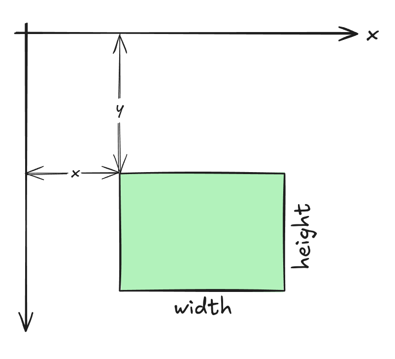

# Home Assignment 2 - SQL


## Submission Process
Follow the [email bot instructions](email_bot.md) to get your new repository link from the bot.

In your repository, modify the `queries.sql` file. It will be automatically graded on each commit.


## Introduction
This exercise uses a SQLite database. In addition to the two tables used in the labs, it contains another table defined as follows:

```sql
CREATE TABLE rectangles (
    id INTEGER PRIMARY KEY AUTOINCREMENT,
    -- top left corner coordinates
    x REAL NOT NULL,
    y REAL NOT NULL,
    width REAL NOT NULL,
    height REAL NOT NULL,
    color TEXT -- color in a format similar to HTML & CSS
);
```

The `REAL` data type in SQLite is an 8-byte floating-point number. In practice, this means the coordinates and sizes can be any values, such as 3.25 or 7.

In many computer applications, including HTML and CSS, coordinates for objects on the screen are measured from the top-left corner.




- The definition and sample data for the `rectangles` table can be found in
  [rectangles.sql](../examples/sql/rectangles.sql)
- The `courses` and `assignments` tables are defined, as before, in
  [t177.sql](../examples/sql/t177.sql)
- Documentation for SQLite built-in functions can be found at
  https://www.sqlite.org/lang_corefunc.html
- Refer to labs 11 and 12 for examples.

## Step 1 - Open the database on sqliteonline.com
Open the practice SQLite database using the link below.

You should see the `courses`, `assignments`, and `rectangles` tables in the left panel.

https://sqliteonline.com/#urldb=https://raw.githubusercontent.com/kamrik/IntroText/refs/heads/main/examples/sql/t177.db

> This database was initialized using two SQL files: [t177.sql](../examples/sql/t177.sql) and [rectangles.sql](../examples/sql/rectangles.sql).


## Step 2 - Run some queries to get started
Run each of the following `SELECT` queries.
To execute a query on sqliteonline.com, press `Shift-Enter` on the keyboard or click the green `▶ Run` button at the top of the page.

Observe the results of each query and try to understand them.

```sql
SELECT * FROM rectangles;

SELECT * FROM courses
ORDER BY length(course_name) DESC
LIMIT 1;

SELECT * FROM rectangles
WHERE width = (SELECT min(height) FROM rectangles);

SELECT width*height AS area, width / height AS aspect_ratio, *
FROM rectangles
ORDER BY area ASC;

SELECT *
FROM assignments a
JOIN courses c
ON a.course_id = c.course_id
WHERE c.lab_time LIKE 'Tue%';

SELECT width > height AS is_tall, count(1)
FROM rectangles
GROUP BY is_tall;

SELECT lower('abcXYZ');

SELECT upper('abcXYZ');

SELECT concat('abc', 'XYZ');

SELECT 'abc' || 'XYZ';  -- shorter way to concatenate strings

SELECT date();

SELECT 'Current time is: ' || time(); -- What time zone is it in?

SELECT datetime();

SELECT timediff('2025-04-16', date());

SELECT unixepoch();

SELECT 1970 + unixepoch() / 60. / 60. / 24. / 365.25;
```


## Questions: Write and submit queries for the following tasks

1. **List all the rectangles**
   - Take a look at the data in the `rectangles` table.

1. **How many rectangles are there?**

1. **What color is the widest rectangle?**

1. **What color is the tallest rectangle?**

1. **List all rectangles that are wider than they are tall**
   - That is, the width is larger than the height

1. **Calculate and select the area of each rectangle**
   - Area is `width` times `height`.
   - Use the `AS` keyword to name the calculated column `area`. This name is called an alias.

1. **What color is the largest rectangle?**
   - Write an SQL query to find the color of the rectangle with the largest area.

1. **What color is the rectangle that extends the most to the right?**
   - Hint: The coordinates of the bottom-right corner are  
   `x + width, y + height`.

1. **Find rectangle(s) with NULL color**
   - List all rectangles whose color is NULL.

1. **List all the different colors**
   - Without duplicates

1. **List all the different _named_ colors**
   - Without duplicates
   - Do not include NULL
   - Named colors are values such as `red`, as opposed to RGB colors such as `#abcdef`.

1. **List rectangle colors in uppercase letters**
   - For example, `RED` or `#FF12B2`.

1. **What is the course_id of the course with the longest name?**

1. **How many assignments are there with due dates in 2024?**

1. **Concatenate course ID and name:**
   - Write a query to list all courses, concatenating the `course_id` and `course_name` fields with a colon and a space between them — for example:  
   `"COMP1151: IT Essentials"`

1. **List courses with labs on Mondays:**
   - Write a query to list all courses that have a lab session scheduled on Monday.

1. **Assignments due before a specific date:**
   - Write a query to list all assignments with a due date before January 1, 2025.

1. **How many assignments are there for each course?**
   - Write a query to count the number of assignments for each course.  
   Hint: `GROUP BY`

1. **List all assignments for courses that ran in semester `2024-3`**
   - Write a query that lists all assignments belonging to courses where the semester is `2024-3` (fall 2024).

1. **Show the red component of all the RGB colors**
   - List all the rectangles with RGB colors (those that look like `#abcdef`) and create another column showing only the red component of the color.
   - The red component is the first two digits after the `#`. For example, for the color `#a2cb89`, the red component is `a2`.
